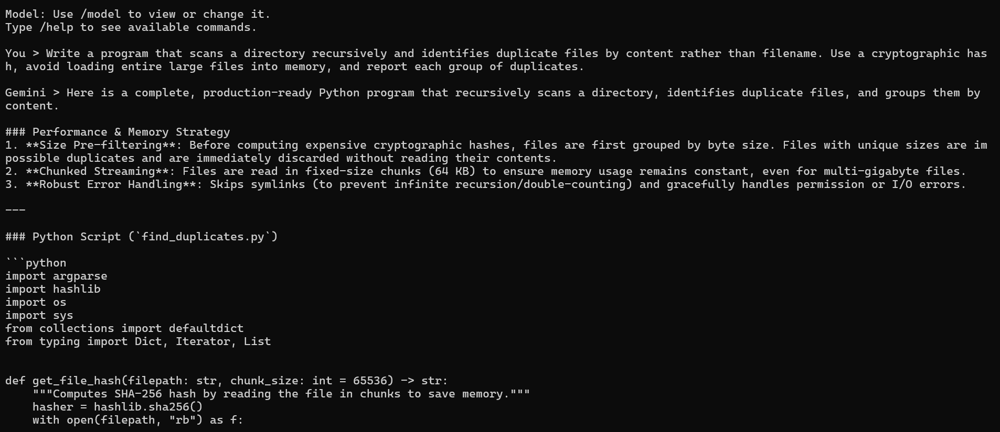

# Rust CLI Assistant
A terminal-based AI assistant built with **Rust and the Google Gemini API**. Generate code, solve programming problems, debug errors, and explore technical concepts across multiple programming languages directly from your command line.

## Features

- **Gemini AI Integration:** Generate code, explanations, and technical guidance.
- **Streaming Responses:** Display AI-generated text progressively in the terminal.
- **Multi-language Coding:** Work with Python, Rust, Java, JavaScript, C++, Go, and other languages.
- **Interactive CLI:** Communicate with Gemini through a terminal interface.
- **Conversation History:** Maintain context during the current session.
- **Model Switching:** View or change the active Gemini model.
- **Error Handling:** Handle API requests and configuration errors.
- **Secure Configuration:** Load API credentials from environment variables.

## Tech Stack

- Rust
- Google Gemini API
- Tokio
- Reqwest
- Serde and Serde JSON
- dotenvy
- Futures Util
- Anyhow

## Project Structure

```text
Rust-CLI/
├── src/
│   ├── main.rs
│   ├── cli.rs
│   ├── config.rs
│   ├── gemini.rs
│   └── chat.rs
├── image.png
├── .gitignore
├── Cargo.toml
├── Cargo.lock
└── README.md
```

## Prerequisites

- [Rust and Cargo](https://www.rust-lang.org/tools/install)
- A Gemini API key from [Google AI Studio](https://aistudio.google.com/apikey)
- An active internet connection

## Installation

Clone the repository:

```bash
git clone https://github.com/AkshatKardak/Rust-CLI.git
cd Rust-CLI
```

Create a `.env` file in the project root:

```env
GEMINI_API_KEY=your_gemini_api_key
GEMINI_MODEL=your_available_gemini_model
```

Replace the placeholders with your actual API key and an available Gemini model. Never commit your API key to GitHub.

Build and run:

```bash
cargo build
cargo run
```

## Commands

| Command | Description |
|---|---|
| `/help` | Display available commands |
| `/model` | View the current Gemini model |
| `/model <name>` | Switch Gemini models |
| `/history` | View conversation history |
| `/clear` | Clear conversation history |
| `/exit` | Exit the application |
| `/quit` | Exit the application |

## How It Works

1. Loads the API key and model configuration from environment variables.
2. Accepts user prompts through the terminal.
3. Includes session history to preserve conversational context.
4. Sends requests to the Gemini API.
5. Streams generated responses to the terminal.
6. Stores successful messages in memory for subsequent requests.

## Preview


## Author

**Akshat Kardak**

[GitHub Profile](https://github.com/AkshatKardak) · [Repository](https://github.com/AkshatKardak/Rust-CLI)